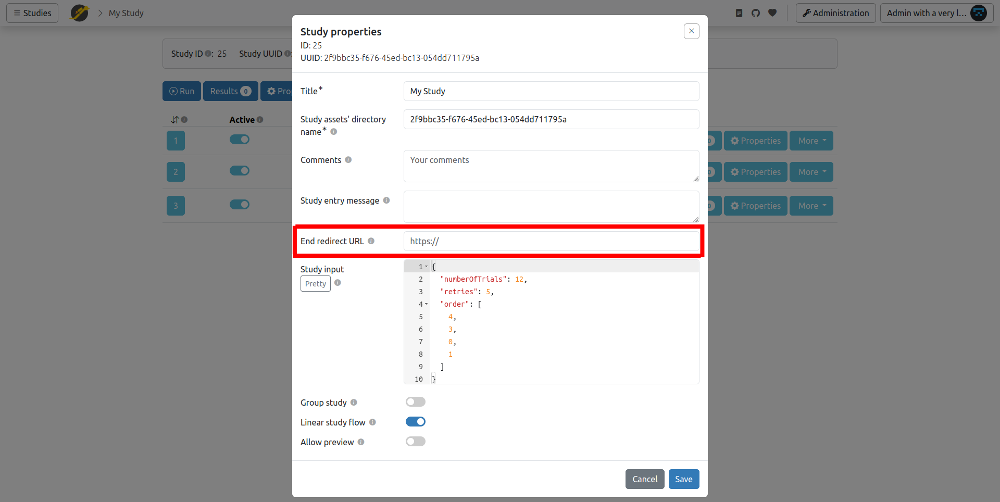

You can use JATOS with [Populiva](https://populiva.com) to recruit participants.

The connection works like this:

1.  You tell Populiva where to send participants to run your JATOS study.
2.  You tell JATOS where to send participants back to Populiva once they finish the study.

### 1. In Populiva: Enter Your JATOS Study Link

When you create a study in Populiva, enter the link to your JATOS study as the **study link**. The link must use `https`. You will most likely want a study link of either the **General Single** or **General Multiple** type (refer to [Run your Study with Study Links](Run-your-Study-with-Study-Links) for more details).

When a participant starts the study, Populiva opens your study link with three URL query parameters added: `PARTICIPANT_ID`, `STUDY_ID`, and `SESSION_ID`. This modifies the JATOS study link you entered, which is expected and fine.

### 2. In JATOS: Redirect to Populiva After the Study is Done

First, get the completion URL from the **Connect your survey** section of your study page in Populiva. It looks like `https://populiva.com/c/STUDY_ID?code=COMPLETION_CODE`.

Now there are **two ways how to tell JATOS the URL**:

1. The easy way is to copy this link into the **End Redirect URL** field within your Study Properties in JATOS:

    

2. In some cases, you might want to handle the redirection from within your JavaScript, **programmatically**, with the [`jatos.endStudyAndRedirect`](jatos.js-Reference#jatosendstudyandredirect) function.

    For example (remember to change this URL to the one you see in Populiva):

    ```javascript
    jatos.endStudyAndRedirect("https://populiva.com/c/STUDY_ID?code=COMPLETION_CODE");
    ```

A Populiva study can have more than one completion code, each with its own outcome (for example, a paid screen-out). The default code sends the submission to manual review. If some participants should end the study with a different code, e.g. because they were screened out or failed an attention check, use `jatos.endStudyAndRedirect` with the completion URL for that code.

-----

## Bonus (Optional) - Use Populiva's URL Parameters in Your Study

You can access the parameters `PARTICIPANT_ID`, `STUDY_ID`, and `SESSION_ID` within your study's JavaScript via [`jatos.urlQueryParameters`](jatos.js-Reference#jatosurlqueryparameters), e.g. `jatos.urlQueryParameters.PARTICIPANT_ID`. `PARTICIPANT_ID` is a pseudonymous ID: it stays the same for a participant across your lab's studies, and is different for each lab. `SESSION_ID` is new for each attempt at the study.

For more information, see [Populiva's guides](https://populiva.com/guides).
